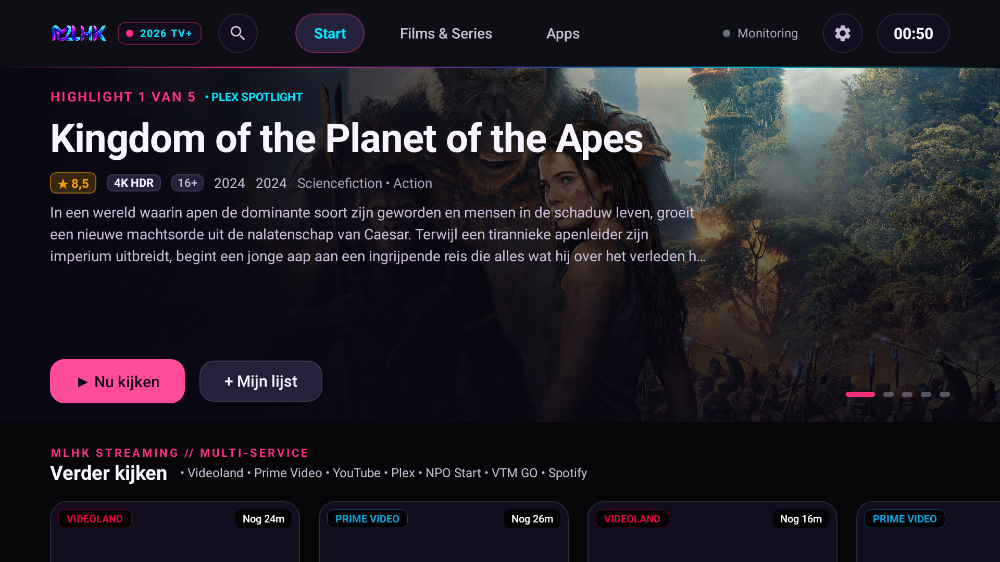
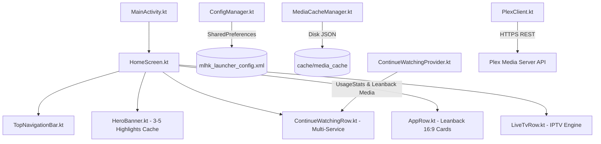

# MLHK TV+ Launcher — Next-Gen Android TV Launcher

[](https://developer.android.com/tv)
[-purple.svg)](https://kpn.com)
[](https://developer.android.com/jetpack/compose/tv)
[](LICENSE)

Een razendsnelle, moderne en aanpasbare Android TV-launcher speciaal geoptimaliseerd voor de **KPN TV+ Box (Sagemcom DIW7022)** en andere Android TV-apparaten. 

Ontworpen voor **0ms opstarttijd**, **0% idle CPU**, naadloze **Plex-integratie**, multi-app **Verder kijken** (Videoland, Prime Video, YouTube, Spotify, NPO Start, VTM GO, etc.) en optionele **Live TV / IPTV** streaming.



---

## 🌟 Belangrijkste Functies

- ⚡ **0ms Instant Startup & Caching**: 1-pass OLED donkere rendering, twee-fasen laden (directe interactieve UI, achtergrond-sync) en persistente schijfcache voor highlights en mediaposters.
- 🎬 **Cinematic Hero Spotlight**: 3 tot 5 roterende highlights uit je eigen Plex-bibliotheek met beoordelingen, metadata en directe afspeelacties.
- 🔄 **Unified "Verder Kijken"**: Toont chronologisch wat je daadwerkelijk als laatst hebt bekeken of geopend over alle geïnstalleerde streamingdiensten heen.
- ⭐ **Configureerbare Favoriete Apps**: Kies zelf je favoriete apps via een geïntegreerd dialoogvenster met ruime padding en 16:9 Leanback-bannerweergave. Voorkeuren worden altijd veilig bewaard bij updates.
- 📺 **IPTV & Live TV Engine**: Ondersteuning voor Xtream Codes API en M3U8 afspeellijsten met geïntegreerde EPG TV-gids (enkel zichtbaar indien geconfigureerd).
- 🔗 **1-Klik Plex PIN Koppeling**: Koppel je Plex Media Server in enkele seconden via `plex.tv/link` zonder handmatig lange tokens in te typen.
- 📡 **Centrale Statusindicator**: Discrete online/offline statusindicator voor netwerk- en zelf-gehoste diensten via een lichtgewicht status-API.
- 🛡️ **Veilig & Herstelbaar**: Geen root vereist, geen KPN firmware-wijzigingen. De originele KPN TV+ launcher blijft altijd 100% beschikbaar.

---

## 🧑‍💻 Installatiehandleiding voor Mensen (Stap-voor-Stap)

### Wat heb je nodig?
1. Een **KPN TV+ Box (Sagemcom DIW7022)** of een andere Android TV / Google TV speler verbonden met hetzelfde lokale Wi-Fi of bekabelde netwerk.
2. Een computer (Windows, macOS of Linux) met **ADB (Android Debug Bridge)** geïnstalleerd.
3. Het IP-adres van je TV-box (bijv. `192.168.2.26`). Je vindt dit via: *Instellingen (tandwiel) ➔ Apparaatvoorkeuren ➔ Netwerk en internet ➔ Status*.

---

### Stap 1: Ontwikkelaarsopties & Netwerkfoutopsporing activeren
1. Druk op de **Tandwiel-knop** (Instellingen) op je afstandsbediening.
2. Ga naar **Apparaatvoorkeuren** ➔ **Over**.
3. Scroll omlaag naar **Android TV-buildversie** en druk **7 keer op OK** op de afstandsbediening totdat de melding verschijnt: *"U bent nu ontwikkelaar!"*.
4. Druk op Terug en open het nieuwe menu **Ontwikkelaarsopties**.
5. Schakel **USB-foutopsporing** én **Netwerkfoutopsporing** (ADB via Wi-Fi/LAN) in.

---

### Stap 2: Verbinden via de computer
Open PowerShell (Windows) of Terminal (macOS/Linux) en voer uit:

```bash
# Vervang met het IP-adres van jouw TV-box:
adb connect 192.168.2.26:5555
```
*Op het televisiescherm verschijnt mogelijk een eenmalige popup: "Foutopsporing via USB/Netwerk toestaan?". Vink **Altijd toestaan** aan en klik op **OK**.*

Controleer of de verbinding actief is:
```bash
adb devices
```
*(Je ziet `192.168.2.26:5555  device` staan).*

---

### Stap 3: Launcher installeren
Installeer de APK met het `-r` vlaggetje (zodat al je favorieten en instellingen altijd behouden blijven):

```bash
adb -s 192.168.2.26:5555 install -r dist/mlhk-tvplus-launcher.apk
```

---

### Stap 4: Launcher starten en instellen
Start de launcher direct op je TV:
```bash
adb -s 192.168.2.26:5555 shell am start -n nl.mlhk.tvlauncher.debug/nl.mlhk.tvlauncher.MainActivity
```

**Als standaard startscherm instellen:**
1. Klik rechtsboven in de launcher op het **Tandwiel** (Instellingen).
2. Kies **Standaard Launcher Instellen**.
3. Selecteer **MLHK TV+ Launcher** en kies **Altijd**.

---

### Stap 5: Instellen van Plex & Favorieten
- **Favoriete apps kiezen**: Klik in de rij *"Mijn favoriete apps"* op de knop **Aanpassen** of open *Instellingen ➔ Favoriete Apps Kiezen*. Vink je gewenste diensten aan en klik op *Klaar*.
- **Plex koppelen**: Open het instellingenmenu op de TV, klik op **Koppel via PIN**. Ga op je telefoon of laptop naar [plex.tv/link](https://plex.tv/link) en voer de getoonde 4-letterige code in. Binnen 2 seconden zijn al je films en series geladen!

---

### 🔄 Veilige Terugkeer naar KPN Launcher (Herstel)
Wil je tijdelijk of permanent terug naar de originele KPN launcher? Voer uit:
```bash
adb -s 192.168.2.26:5555 shell am start -n com.kpn.tvlauncher/.MainActivity
```
Of schakel de standaard launcher in Android instellingen terug naar *KPN TV+*.

---

## 🤖 AI Agent & Automated Developer Guide

Deze sectie bevat specificaties en commando's voor LLM-agents, autonomous coders en CI/CD pipelines.

### Architectuurspecificatie



### Technische Referentiedata

| Parameter | Waarde |
| :--- | :--- |
| **Package Name** | `nl.mlhk.tvlauncher.debug` (of `nl.mlhk.tvlauncher` in release) |
| **Main Activity** | `nl.mlhk.tvlauncher.MainActivity` |
| **Target SDK / Min SDK** | Target SDK 34 / Min SDK 28 (Android 9.0+) |
| **Target Device Hardware** | Sagemcom DIW7022 (Realtek RTD1319D, Mali-G57, 4GB RAM) |
| **Config Store** | `/data/data/nl.mlhk.tvlauncher.debug/shared_prefs/mlhk_launcher_config.xml` |
| **Disk Cache Dir** | `/data/data/nl.mlhk.tvlauncher.debug/cache/media_cache/highlights_cache.json` |

### Belangrijkste Intent Filters & Launch Commands

```bash
# 1. Start Launcher explicit
adb shell am start -n nl.mlhk.tvlauncher.debug/nl.mlhk.tvlauncher.MainActivity

# 2. Trigger Standard Home Key
adb shell input keyevent KEYCODE_HOME

# 3. Open Android Home Settings to select default launcher
adb shell am start -a android.settings.HOME_SETTINGS

# 4. Check currently focused activity
adb shell dumpsys window | grep -E "mCurrentFocus"
```

### SharedPreferences Structuur (`mlhk_launcher_config.xml`)

AI-agents die op afstand configuraties injecteren kunnen direct de XML manipuleren:
```xml
<?xml version='1.0' encoding='utf-8' standalone='yes' ?>
<map>
    <string name="plex_host">https://plex.yourdomain.com</string>
    <string name="plex_token">YOUR_TOKEN_HERE</string>
    <set name="favorite_apps">
        <string>nl.rtl.videoland.v2</string>
        <string>com.google.android.youtube.tv</string>
        <string>com.spotify.tv.android</string>
        <string>com.amazon.amazonvideo.livingroom</string>
        <string>com.plexapp.android</string>
        <string>nl.uitzendinggemist</string>
        <string>be.vmma.vtm.zenderapp</string>
    </set>
    <string name="iptv_type">xtream</string>
    <string name="iptv_server">http://provider.url:8080</string>
</map>
```

### Builden vanaf Source

```bash
# Windows
.\gradlew.bat assembleDebug

# Linux / macOS
./gradlew assembleDebug

# Output locatie:
# app/build/outputs/apk/debug/app-debug.apk
```

---

## 📁 Repository Structuur

```
android_tv_launcher/
├── app/
│   ├── src/main/java/nl/mlhk/tvlauncher/
│   │   ├── MainActivity.kt               # TV Lifecycle & D-Pad event handler
│   │   ├── MlhkApplication.kt            # Application Context & Cache Init
│   │   ├── data/
│   │   │   ├── AppManager.kt             # Package scanning, banners & deep-links
│   │   │   ├── ConfigManager.kt          # SharedPreferences persistence
│   │   │   ├── ContinueWatchingProvider.kt# Multi-app status scanner & sort
│   │   │   ├── MediaCacheManager.kt      # Fast offline JSON disk cache
│   │   │   ├── PlexClient.kt             # Plex PIN linking & HTTPS library calls
│   │   │   └── StatusClient.kt           # Central monitoring API client
│   │   ├── iptv/                         # IPTV M3U/Xtream player & organizer
│   │   ├── model/                        # Datamodels (Plex, Apps, IPTV, Status)
│   │   └── ui/
│   │       ├── HomeScreen.kt             # Primary LazyColumn container
│   │       ├── components/               # HeroBanner, AppRow, LiveTvRow, Dialogs
│   │       └── theme/                    # MLHK 2026 Core Color & Typography
├── dist/
│   └── mlhk-tvplus-launcher.apk          # Voorgebouwde direct-installeerbare APK
├── docs/                                 # Aanvullende documentatie & screenshots
├── build.gradle.kts                      # Gradle build instellingen
└── README.md                             # Deze installatiegids
```

---

## ⚖️ Licentie & Vrijwaring

Dit project is ontwikkeld voor educatieve doeleinden en persoonlijk gebruik. Merknamen zoals KPN, Plex, Videoland, YouTube en Netflix zijn eigendom van hun respectievelijke merkhouders. Deze launcher maakt uitsluitend gebruik van openbare Android TV API's en deep-links en omzeilt geen DRM of beveiligingsmechanismen.
